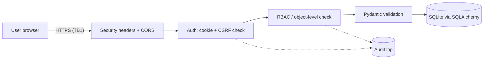

# Support CRM – Secure Ticket Management System

A role-based customer-support ticket system (FastAPI + SQLAlchemy/SQLite + vanilla JavaScript) built for the
*Secure Web Development* CA (MSCCYBBFD). The original version was an open CRUD API with no login; this version
was **re-engineered with security as the main goal**: authentication, role-based and object-level authorization,
input validation, injection/XSS/CSRF protection, audit logging and automated security testing.

> Author: Ananya Musale · Module: Secure Web Development · Lecturer: Dr. Zakaria Sabir

## 1. Features and security objectives

| Area | Functionality | Security objective |
|---|---|---|
| Accounts | Register (customers), login, logout, admin user management | Strong passwords, Argon2id hashing, brute-force lockout |
| Tickets (CRUD) | Create, view, search/filter, update status & notes, delete | Role checks + object-level checks on every endpoint |
| Roles | `customer`, `agent`, `admin` | Least privilege, enforced **server-side** |
| Admin | Change roles, deactivate users, read audit log | Accountability, no self-promotion |
| UI | Responsive dashboard, dark mode | No `innerHTML`, strict CSP, no third-party scripts |

### Roles and privileges

| Action | Customer | Agent | Admin |
|---|:-:|:-:|:-:|
| Create ticket | ✅ | ✅ | ✅ |
| View tickets | own only | all | all |
| Update status / notes | ❌ | ✅ | ✅ |
| Delete ticket | ❌ | ❌ | ✅ |
| Manage users / read audit log | ❌ | ❌ | ✅ |

## 2. Security improvements (what I changed from the original app)

| # | Original weakness | Fix implemented | Where |
|---|---|---|---|
| 1 | No login – anyone could read/edit/delete tickets | Login with Argon2id password hashes; JWT in `HttpOnly`, `SameSite=Strict` cookie, 30 min expiry | `auth.py`, `main.py` |
| 2 | No roles | 3 roles, checked in a reusable `require_roles()` dependency; role re-read from the DB on each request | `auth.py` |
| 3 | Any ticket readable by ID (IDOR) | `_load_ticket()` enforces ownership; foreign tickets return 404 | `main.py` |
| 4 | `allow_origins=["*"]` with credentials | CORS closed by default (same-origin app); explicit allow-list via `.env` | `main.py`, `config.py` |
| 5 | Guessable ticket IDs (`random.randint(1000,9999)`) | `secrets.token_hex` – 32 bits of CSPRNG randomness, collision-checked | `main.py` |
| 6 | No input validation | Pydantic: length limits, e-mail validation, status whitelist, control-char rejection, password policy | `schemas.py` |
| 7 | SQL injection risk in search | SQLAlchemy bound parameters + `contains(..., autoescape=True)` | `main.py` |
| 8 | Stored XSS (`innerHTML` with user data) | All rendering via `textContent`; strict CSP (`script-src 'self'`) | `frontend/*.js`, `security.py` |
| 9 | CSRF | `SameSite=Strict` cookie **and** per-session CSRF token (`X-CSRF-Token`, constant-time compare) | `auth.py` |
| 10 | Brute-force logins | Account lock after 5 failures (15 min) + per-IP rate limit; generic error + dummy hash to stop user enumeration | `main.py`, `security.py` |
| 11 | No audit trail | `audit_logs` table: logins, failures, lockouts, ticket create/update/delete, role changes | `models.py`, `auth.py` |
| 12 | Info leaks / wrong status codes | 401/403/404/422/429 used correctly; global handler hides stack traces; API docs disabled by default | `main.py` |
| 13 | Missing headers | CSP, `X-Frame-Options`, `nosniff`, `Referrer-Policy`, `Permissions-Policy`, `Cache-Control: no-store` on API, HSTS when HTTPS | `security.py` |
| 14 | Hard-coded config, DB file in repo | Settings from environment (`.env`), `.gitignore` for `.env`/`*.db`; no default secret key | `config.py`, `.gitignore` |
| 15 | Customer could spoof name/e-mail | Name/e-mail taken from the logged-in account, not from the request | `main.py` |

## 3. Project structure

```
.
├── README.md                    ← this file
├── .gitignore                   ← keeps secrets, databases and caches out of Git
└── support-crm/
    ├── backend/
    │   ├── main.py              ← API routes (auth, tickets CRUD, admin) + serves the front end
    │   ├── auth.py              ← Argon2 hashing, JWT, CSRF check, get_current_user, require_roles, audit()
    │   ├── security.py          ← security-headers middleware, rate limiter
    │   ├── schemas.py           ← Pydantic validation models
    │   ├── models.py            ← SQLAlchemy tables: users, tickets, audit_logs
    │   ├── database.py          ← engine / session
    │   ├── config.py            ← settings from environment variables
    │   ├── seed.py              ← creates demo admin / agent / customer users
    │   ├── requirements.txt     ← runtime dependencies (pinned)
    │   ├── requirements-dev.txt ← + pytest, bandit, pip-audit
    │   ├── .env.example         ← template for your private .env
    │   └── tests/               ← functional + security tests (pytest)
    ├── frontend/                ← login, dashboard, create, ticket detail, admin (HTML + JS + CSS)
    └── docs/                    ← test/SAST reports and screenshots used in the report
```

## 4. Setup and installation

Requires Python 3.10+.

```bash
cd support-crm/backend
python -m venv venv
source venv/bin/activate            # Windows: venv\Scripts\activate
pip install -r requirements-dev.txt

cp .env.example .env                # Windows: copy .env.example .env
# put a random value in SECRET_KEY:
python -c "import secrets; print(secrets.token_urlsafe(64))"

python seed.py                      # creates admin1 / agent1 / customer1 (prints passwords once)
# or choose one demo password:  SEED_PASSWORD='YourStrongPass123' python seed.py

uvicorn main:app --reload
```

Open <http://127.0.0.1:8000> – the API and the front end are served from the same origin.

> **Upgrading from the old version:** the database schema changed. Delete the old `tickets.db` once, then run `seed.py`.

## 5. Usage

1. Open `/login.html` and sign in (or **Register** – new accounts are always customers).
2. **Customer:** *+ New ticket* → fill subject/description → see only your own tickets.
3. **Agent:** open any ticket → change status / add notes → *Save*.
4. **Admin:** delete tickets, open **Admin** to change roles, deactivate users and read the audit log.
5. Use the search box and status filter on the dashboard.

## 6. Testing process

```bash
cd support-crm/backend
python -m pytest -v                          # 37 functional + security tests
bandit -r . -x ./tests                       # SAST
pip-audit -r requirements.txt                # dependency vulnerabilities
```

| Type | Tool | Result |
|---|---|---|
| Functional | pytest (`tests/test_functional.py`) | 9 tests – register/login, CRUD, search, roles, admin |
| Security | pytest (`tests/test_security.py`) | 28 tests – see table below |
| SAST | Bandit 1.9.4 | 0 issues (2 low findings – `assert` statements – found and removed, see `docs/sast-bandit-report.txt`) |
| Dependencies | pip-audit | No known vulnerabilities (`docs/pip-audit-report.txt`) |
| Manual / UI | Playwright browser run | XSS payload displayed as text, no CSP violations, role UI correct (`docs/screenshots/`) |

**Three major security features tested in depth (for the report):**

| Feature | Test cases | Result |
|---|---|---|
| Authentication & brute-force protection | wrong passwords ×5 then correct password → 429; same error for unknown/known user; forged, expired and `alg=none` JWTs rejected | Pass |
| Authorization (RBAC + IDOR) | customer→update/delete 403; agent→delete/admin 403; Bob requests Alice's ticket → 404; self-registration with `role=admin` stays customer | Pass |
| Injection & XSS protection | 4 SQLi payloads in search, status, login, URL path; `<script>` stored as text; no `innerHTML` in front end; CSP header present | Pass |

I also verified the tests can fail: removing the ownership check or the admin-only decorator makes the matching tests fail.

## 7. Security requirements status

| ID | Requirement | Status | % |
|---|---|---|---|
| SR1 | Authentication: hashed passwords, password policy, lockout | Completed | 100 |
| SR2 | Session management: HttpOnly/SameSite cookie, expiry, logout, CSRF token | Completed | 100 |
| SR3 | Authorization: RBAC + object-level checks, least privilege | Completed | 100 |
| SR4 | Input validation & output encoding (SQLi, XSS) | Completed | 100 |
| SR5 | Error handling: generic errors, correct status codes, no stack traces | Completed | 100 |
| SR6 | Auditing & logging of security events | Completed | 100 |
| SR7 | Secure configuration: env secrets, headers, CORS, docs off | Completed | 100 |
| SR8 | Transport security (HTTPS/HSTS) | In progress | 70 |
| SR9 | Testing: functional, SAST, dependency scan, security tests | Completed | 100 |
| SR10 | Multi-process rate limiting / MFA | Not started | 0 |

## 8. Design: data flow and trust boundaries



STRIDE summary: **S**poofing → Argon2 + JWT + lockout · **T**ampering → validation, CSRF, parameterised queries ·
**R**epudiation → audit log · **I**nformation disclosure → IDOR checks, generic errors, no-store, CSP ·
**D**oS → length limits, rate limiting · **E**levation of privilege → server-side RBAC, role never taken from the client.

## 9. Known limitations (honest notes)

* Rate-limiting is in-memory (single process); a production deployment would use Redis or a gateway.
* HTTPS is not terminated by the app; set `COOKIE_SECURE=true` behind a TLS proxy.
* No MFA, e-mail verification or password reset yet.
* SQLite is used for simplicity; use PostgreSQL in production.

## 10. Contributions and references

* Original app (CRUD tickets, Tailwind UI) – my earlier work. **New in this project:** everything in section 2.
* Libraries: FastAPI, SQLAlchemy, Pydantic, argon2-cffi, PyJWT, pytest, Bandit, pip-audit.
* [1] OWASP, "OWASP Top 10:2021," 2021. [Online]. Available: https://owasp.org/Top10/
* [2] OWASP, "Application Security Verification Standard (ASVS) 4.0," 2019. [Online]. Available: https://owasp.org/www-project-application-security-verification-standard/
* [3] OWASP, "Password Storage Cheat Sheet." [Online]. Available: https://cheatsheetseries.owasp.org/cheatsheets/Password_Storage_Cheat_Sheet.html
* [4] OWASP, "Cross-Site Request Forgery Prevention Cheat Sheet." [Online]. Available: https://cheatsheetseries.owasp.org/cheatsheets/Cross-Site_Request_Forgery_Prevention_Cheat_Sheet.html
* [5] A. Biryukov, D. Dinu and D. Khovratovich, "Argon2: the memory-hard function for password hashing," 2015.

**AI declaration:** I used Claude (Anthropic) as a coding and learning assistant for this project; I reviewed, ran and understood the code and I am responsible for the submission.
